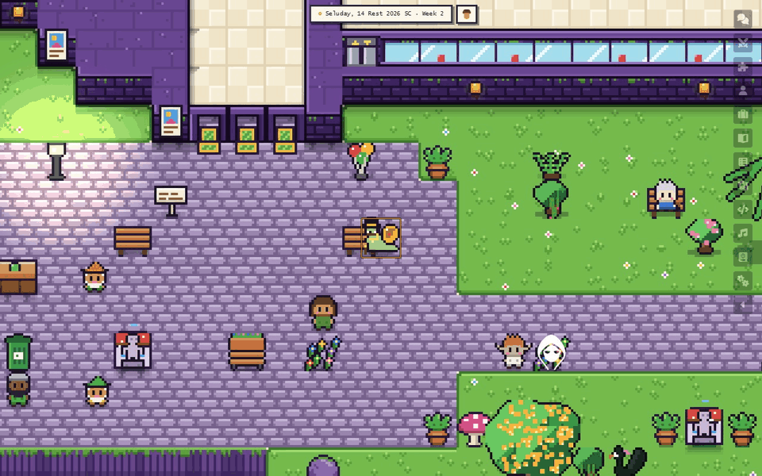
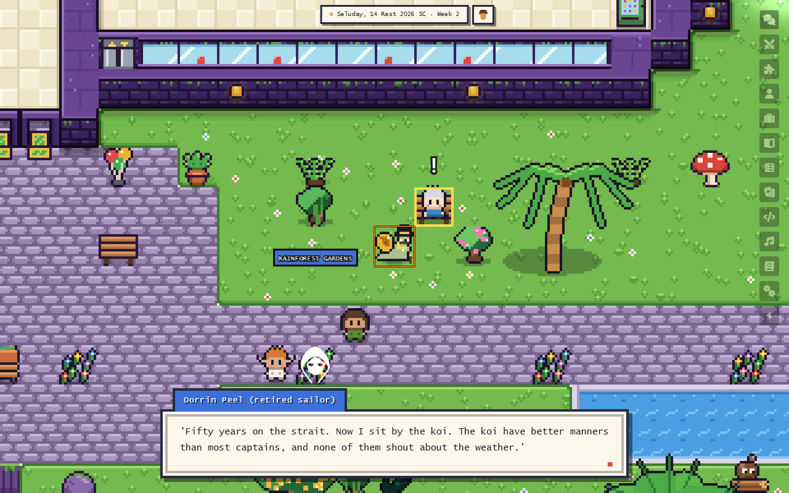
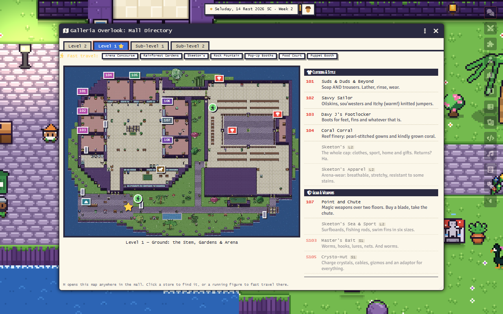
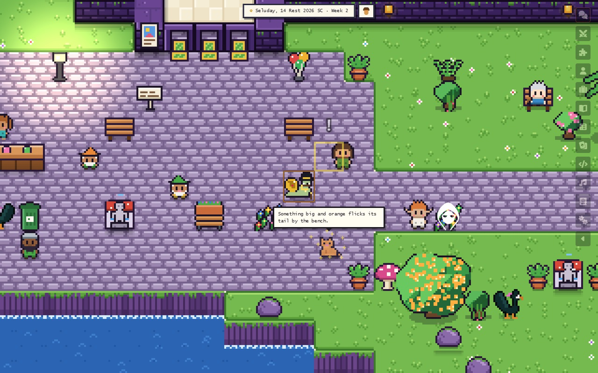
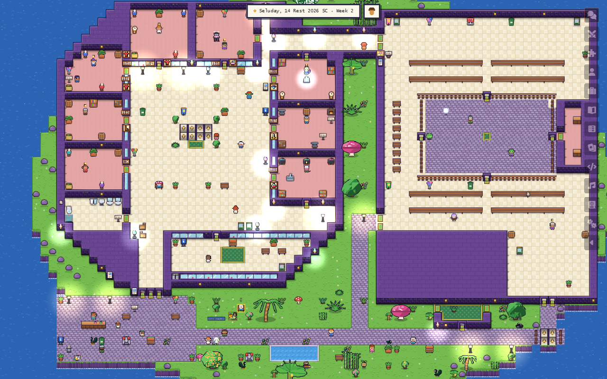
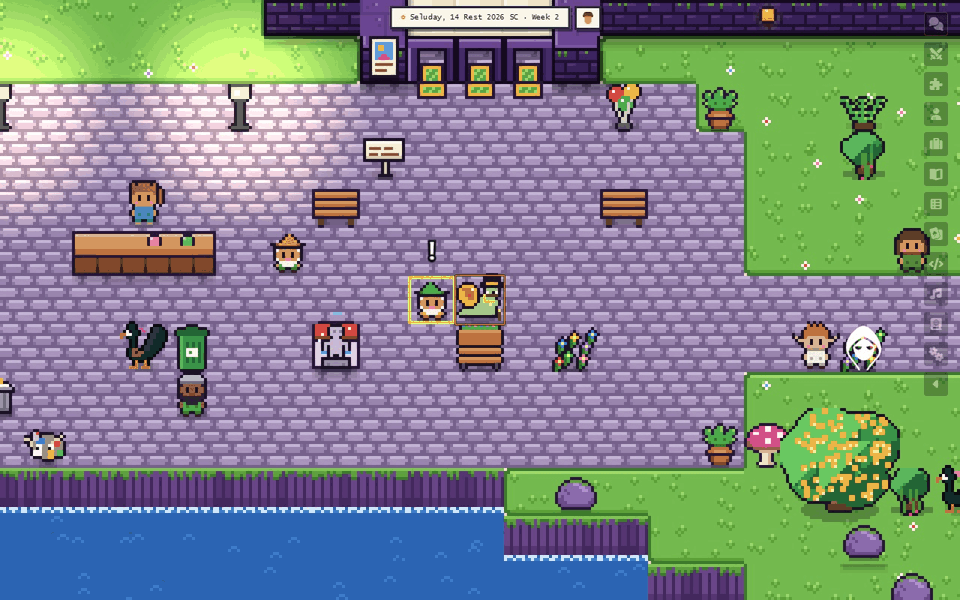
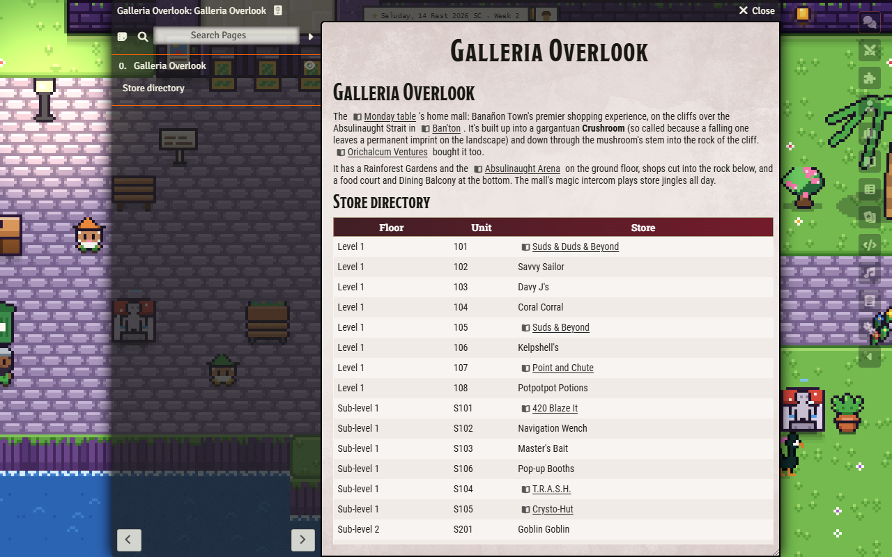
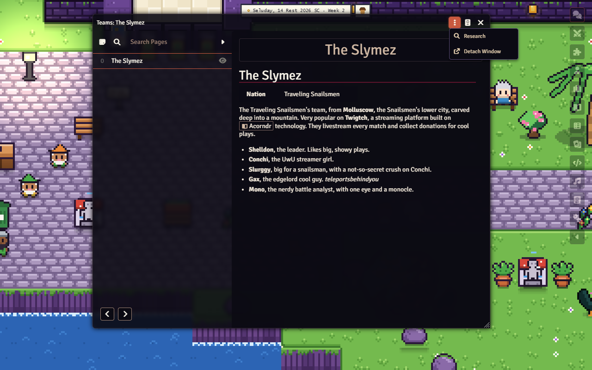
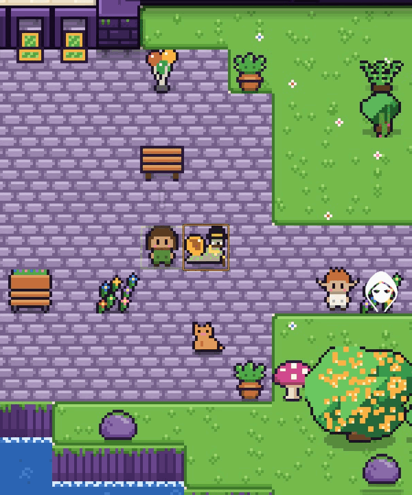
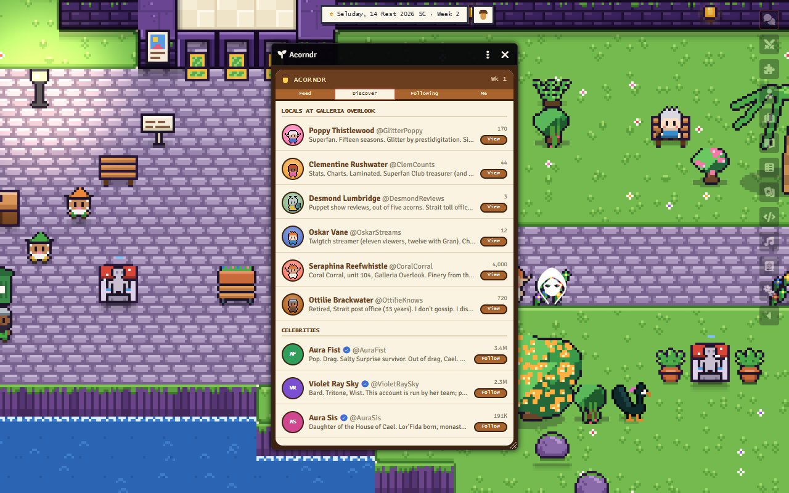

# Foundry VTT campaign modules

Three [Foundry Virtual Tabletop](https://foundryvtt.com) modules I wrote for **MALL BRAWL**, my homebrew D&D 5e campaign. In it, teams of misfits fight in arena matches staged inside fantasy shopping malls. Between sessions, my players log in and walk around the malls, talk to the people who live there, find secrets, and read up on the world.

The campaign runs on [The Forge](https://forge-vtt.com) for two weekly tables (nine players). I update the modules every week, based on what happened at the table.

| Module | What it is |
|---|---|
| [`maul-mall-explorer`](maul-mall-explorer) | 8-bit, Pokémon-style exploration of the campaign's malls, built on top of Foundry's map canvas |
| [`maul-campaign-codex`](maul-campaign-codex) | A lore wiki that players unlock through research rolls |
| [`acorndr`](acorndr) | A phone-style social media app for the game world. Standalone and reusable; any module can feed it content |

About 12,000 lines of JavaScript (Foundry v14 API) and 6,800 lines of Python that generates the content and art.

---

## Mall Explorer

Players move their token with the arrow keys or WASD. The mall is drawn tile by tile from a JSON map: shops on several floors, a rainforest garden, an arena, a food court.

- **A living mall.** NPCs breathe, look around and wander. As you pass, they mutter one-liners in speech bubbles, and near a group you can overhear their conversation. Press **E** to talk; the dialogue box types itself out.
- **Hidden things.** Walking near a hidden spot checks the character's passive Perception. Characters with low Perception can still search with **F**. Secret areas look like plain wall until that player has found the way in.
- **Knows what you know.** Dialogue changes with what each character has already discovered. Names that have a codex entry are underlined and link straight to it.
- **Mall Directory (M).** Floor maps with a "you are here" star, the store list, and fast travel between spots.
- **A weekly season clock.** Each table keeps its own week. Pop-up booths rotate, food-court stalls serve a dish of the week, and gossip refreshes after each match.
- **Things to do.** Store shopping paid in campaign currency, practice bouts with coaches, a weekly Bastion turn for players who work at a store, shows at the theatre, and a notebook (**J**) for players' own notes.
- **The players are in it too.** Each player character is drawn as their own 8-bit sprite. Their store has a stand-in that says the line they wrote for the week while they're away.
- **A GM loop.** GM tools export every character's discoveries as one file. I write the next week's content from that file and the session transcripts, then load it back as an update file.

| | |
|---|---|
|  |  |
| Talking to an NPC | The Mall Directory |
|  |  |
| Noticing something hidden (passive Perception) | Galleria Overlook, ground floor |

**The art is generated, not drawn.** Every tile, prop, NPC sprite and shop sign comes from the Python tools in [`maul-mall-explorer/tools`](maul-mall-explorer/tools) (`pixcore.py`, `mall_tiles.py`, `mall_sprites.py`, `shop_signs.py`, …). Each tool draws pixel art in code with a shared palette and writes PNG sprite sheets. `render_mall.py` turns a mall's JSON into a full map preview.

## Campaign Codex

A wiki of the season's rules, teams, people, places, sponsors and the competitors' shop. Each player sees only what their table has learned. On any entry, a player can try **Research** once per week, with an Investigation roll. Success unlocks a fact for the whole table.

The codex is built by a Python script (not included here) that reads my campaign notes, writes Foundry compendium packs, and checks them against Foundry's own data models. At runtime, `scripts/codex.js` syncs those packs into the world, gives each player their own character and store pages, and tracks unlocks for each table.

| | |
|---|---|
|  |  |
| A codex page: entries link to each other | Research from any entry |

## Acorndr

Th'Tief, the campaign world, has its own social media. Press **P** to open it on a phone-style screen. You can follow celebrities and public accounts, read the week's posts, and give acorns (likes). Locals have to be "friended" in person first: you meet them in the mall. Content comes in content sets that other modules register, so the app isn't tied to this campaign. The MALL BRAWL set ships inside the mall explorer.

| | |
|---|---|
|  |  |
| The feed, acorns, and a local's profile | Discover |

---

## Running it

The modules need Foundry v14 and the `dnd5e` system. The mall explorer requires `acorndr`. To install, copy the three folders into Foundry's `Data/modules` and enable them in a world. On first login, the GM is offered the setup: building scenes, placing NPCs, and creating player users from `data/players.json` (the player names in this copy are placeholders).

This is a working campaign, not a polished package. The content is written for my tables, and a few GM-side tools and sources stay private. I built these modules with Claude Code as a pair programmer. I designed the campaign, the systems and the rules, and I test every change with my players.

## About me

Molecular biologist who creates. I'm the founder of Sploosh, and I prototype tools with Claude Code. More at [github.com/Zak-Does-Science](https://github.com/Zak-Does-Science).
